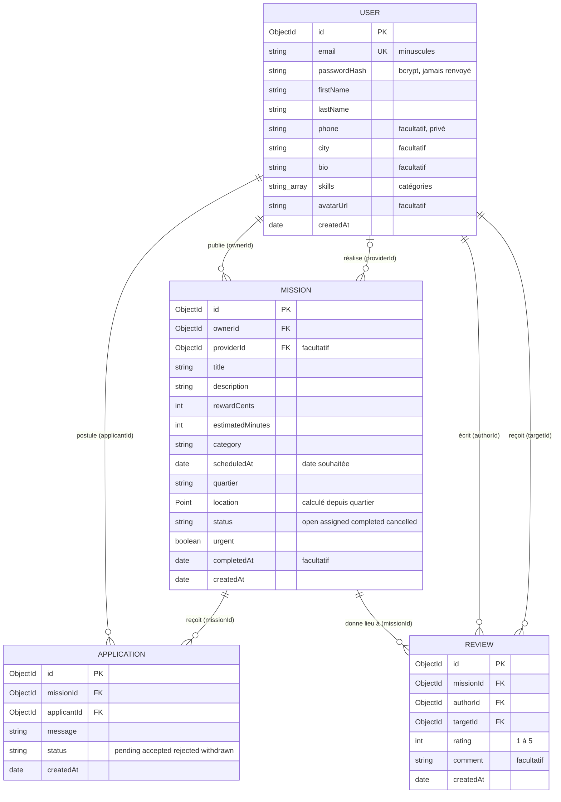

# Modèle de données — HelpUP

Référence commune pour les modèles Mongoose (`backend/src/models/`), le script de structure (`backend/sql/`) et les données de démo (`backend/migration/`).
Un changement ici = prévenir les deux autres et mettre à jour `backend/sql/seed.js` (puis recopier son bloc dans `backend/migration/seed-demo.js`).

## Conventions

- **Code en anglais, camelCase** (le livret impose `ownerId` et `id`). Correspondance avec la maquette ci-dessous.
- Les réponses de l'API exposent **`id`**, jamais `_id` ni `__v`.
- **`createdAt` / `updatedAt`** automatiques (`timestamps: true` dans Mongoose).
- **Argent en centimes entiers** : `4500` = 45 €. Pas d'erreur d'arrondi.
- Les champs marqués **serveur** sont calculés par l'API ; s'ils arrivent dans le corps d'un POST/PATCH → `400`.
- `?` = facultatif.

| Maquette | Code | | Maquette | Code |
|---|---|---|---|---|
| nom / prenom | `lastName` / `firstName` | | temps_estime | `estimatedMinutes` |
| mot_de_passe HASH | `passwordHash` | | localisation | `quartier` + `location` |
| telephone | `phone` | | date_creation | `createdAt` |
| competences | `skills` | | id_auteur (mission) | `ownerId` |
| avatar | `avatarUrl` | | id_prestataire | `providerId` |
| remuneration | `rewardCents` | | id_candidat | `applicantId` |
| categorie | `category` | | id_auteur / id_destinataire (avis) | `authorId` / `targetId` |
| note | `rating` | | message (avis) | `comment` |

---

## Diagramme



---

## User (`users`)

| Champ | Type | Oblig. | Contraintes | Visible par |
|---|---|---|---|---|
| `email` | String | oui | unique, minuscules, format email | lui seul |
| `passwordHash` | String | oui | bcrypt coût 10 ; mot de passe ≥ 8 car. avant hachage ; `select: false` | **personne** |
| `firstName` | String | oui | 1–50 car. | tous |
| `lastName` | String | oui | 1–50 car. | lui seul (public : initiale, « Thomas D. ») |
| `phone` | String | non | `^0[1-9][0-9]{8}$` | lui seul |
| `city` | String | non | ≤ 80 car. | tous |
| `bio` | String | non | ≤ 500 car. | tous |
| `skills` | [String] | non (défaut `[]`) | valeurs de `CATEGORIES`, ≤ 8 | tous |
| `avatarUrl` | String | non | URL `https` (pas d'upload dans le MVP : initiales sinon) | tous |

- **Ajouté** : `city` (le profil public dit où est la personne).
- **Protégé** : email, téléphone et nom complet ne sont jamais montrés aux autres (prestataires de 16 à 25 ans).
- **Calculé, pas stocké** : note moyenne et nombre d'avis (sur `reviews`), nombre de missions réalisées (`missions` où `providerId` = lui et `status = completed`).

## Mission (`missions`)

| Champ | Type | Oblig. | Contraintes | Fixé par |
|---|---|---|---|---|
| `ownerId` | ObjectId → User | oui | — | **serveur** (JWT) |
| `providerId` | ObjectId → User | non | rempli quand une candidature est acceptée | **serveur** |
| `title` | String | oui | 5–80 car. | client |
| `description` | String | oui | 10–1000 car. | client |
| `rewardCents` | Number | oui | entier, 500 à 50 000 (5 € à 500 €) | client |
| `estimatedMinutes` | Number | oui | entier, 15 à 480 | client |
| `category` | String | oui | valeur de `CATEGORIES` | client |
| `scheduledAt` | Date | oui | dans le futur à la création | client |
| `quartier` | String | oui | slug de `QUARTIERS` | client |
| `location` | GeoJSON Point | oui | `{ type: 'Point', coordinates: [lng, lat] }` | **serveur** (depuis `quartier`) |
| `status` | String | oui | `open` · `assigned` · `completed` · `cancelled`, défaut `open` | **serveur** |
| `urgent` | Boolean | non | défaut `false` | client |
| `completedAt` | Date | non | rempli au passage à `completed` | **serveur** |

- **Ajouté** : `scheduledAt` (**la date de la mission** manquait : seule la date de création existait), `completedAt`, `urgent`.
- **Localisation découpée** : l'utilisateur choisit un `quartier`, le serveur en déduit `location`. Impossible d'envoyer de fausses coordonnées, et la carte fonctionne sans API de géocodage.

```
            accepter une candidature          terminer
  open ─────────────────────────────► assigned ──────────► completed
    │                                     │
    │ annuler                             │ annuler (bonus)
    ▼                                     ▼
 cancelled ◄──────────────────────────────┘
```

- `PATCH` / `DELETE` de la mission : seulement si `status = open`.
- `open → assigned` : uniquement en acceptant une candidature (remplit `providerId`).
- `assigned → completed` : uniquement par le propriétaire.

## Application (`applications`)

| Champ | Type | Oblig. | Contraintes | Fixé par |
|---|---|---|---|---|
| `missionId` | ObjectId → Mission | oui | mission existante et `open` | client |
| `applicantId` | ObjectId → User | oui | ≠ `mission.ownerId` | **serveur** (JWT) |
| `message` | String | oui | 10–500 car. | client |
| `status` | String | oui | `pending` · `accepted` · `rejected` · `withdrawn`, défaut `pending` | **serveur** |

- Une seule candidature par personne et par mission (**index unique**).
- `pending → withdrawn` par le candidat ; `pending → accepted | rejected` par le propriétaire.
- Accepter : la mission passe `assigned` avec `providerId`, les autres candidatures `pending` passent `rejected`.

## Review (`reviews`) — bonus

| Champ | Type | Oblig. | Contraintes | Fixé par |
|---|---|---|---|---|
| `missionId` | ObjectId → Mission | oui | mission `completed` | client |
| `authorId` | ObjectId → User | oui | `ownerId` ou `providerId` de la mission | **serveur** (JWT) |
| `targetId` | ObjectId → User | oui | **l'autre** participant | **serveur** (déduit de la mission) |
| `rating` | Number | oui | entier 1 à 5 | client |
| `comment` | String | non | ≤ 500 car. (le « message » de la maquette, rendu facultatif) | client |

- Un avis par auteur et par mission (**index unique**). `targetId` n'est jamais envoyé par le client : sinon on pourrait noter n'importe qui.

---

## Index

| Collection | Index | Sert à |
|---|---|---|
| `users` | `{ email: 1 }` unique | Connexion, `409 EMAIL_ALREADY_USED` |
| `missions` | `{ location: '2dsphere' }` | Carte, recherche par rayon |
| `missions` | texte sur `title` + `description` (français) | Recherche par mots-clés |
| `missions` | `{ status: 1, category: 1, rewardCents: 1 }` | Filtres du catalogue |
| `missions` | `{ ownerId: 1, createdAt: -1 }` | « Mes missions publiées » |
| `missions` | `{ providerId: 1, status: 1 }` | « Missions obtenues », historique |
| `applications` | `{ missionId: 1, applicantId: 1 }` unique | Pas de double candidature |
| `applications` | `{ applicantId: 1, createdAt: -1 }` | « Mes candidatures » |
| `applications` | `{ missionId: 1, status: 1 }` | Candidats d'une mission |
| `reviews` | `{ missionId: 1, authorId: 1 }` unique | Un avis par mission |
| `reviews` | `{ targetId: 1 }` | Note moyenne d'un profil |

## Listes de référence

Une seule source, dans `backend/src/constants/` : `categories.ts` (8 catégories, mêmes slugs que les icônes de la charte) et `quartiers.ts` (11 quartiers de Paris sud et de Villejuif, avec leurs coordonnées).

## Scripts (mongosh, exécutables sur Atlas)

| Fichier | Effet |
|---|---|
| `backend/sql/seed.js` | Base **vide** : collections, règles de validation (`$jsonSchema`), index. Relançable sans risque |
| `backend/migration/seed-demo.js` | Même structure **+ données de démo** (identiques à chaque exécution). `RESET = true` remplace uniquement les données `@helpup.test` |

Lancement en une commande : `npm run db:demo` (ou `npm run db:create`) dans `backend/`. Comptes de démo : voir le README, section « Base de données ».
Les listes (catégories, quartiers, statuts) sont recopiées dans ces scripts : toute modification de `backend/src/constants/` doit y être reportée.
