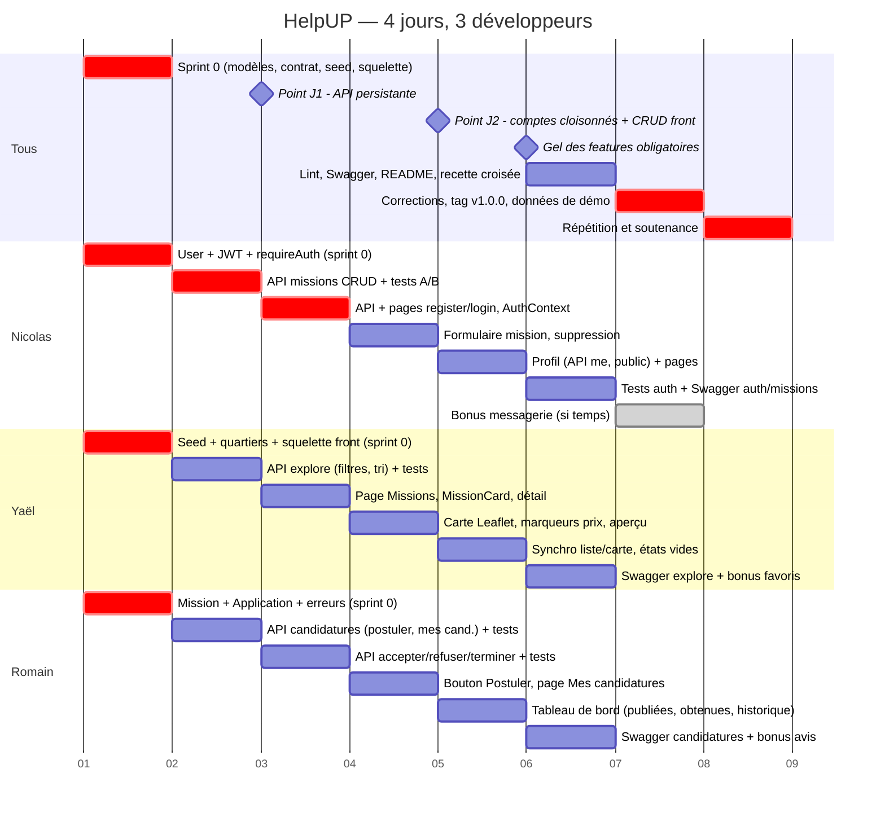

# Plan de développement — HelpUP

Équipe : **Nicolas**, **Romain**, **Yaël** · 4 jours de 7 h (28 h) · soutenance à la fin de J4.
Objectif : que chacun avance **sans attendre les autres** dès la fin de la première matinée.

---

## 1. Ce qui bloquait dans le plan initial

| # | Problème | Conséquence | Correction |
|---|---|---|---|
| 1 | Nicolas porte **l'auth ET les missions** | Tout le monde attend Nicolas : Yaël a besoin de missions à chercher, Romain de missions et d'utilisateurs pour candidater | Les **modèles** et le **middleware JWT** sont faits en commun dans le *sprint 0* (J1 matin). Un script de seed fournit des comptes, des jetons et 25 missions dès 10 h 30 |
| 2 | Rôles « étudiant / client / admin » | Chaque écran doit gérer 3 cas, l'admin est un projet à lui seul | **Un seul type de compte** : tout le monde peut publier et postuler (on ne postule pas à sa propre mission). Admin → hors périmètre |
| 3 | « Gestion des missions » (Romain) et « Publication » (Nicolas) touchent toutes les deux au **statut** | Conflits de code et de règles | Nicolas crée/modifie/supprime (statut toujours `open`). **Seul Romain change le statut**, via les candidatures (`assigned`) et la clôture (`completed`) |
| 4 | Localisation non définie | Pas de coordonnées = pas de carte ; le géocodage d'adresse est un sujet en soi | Liste fixe de **quartiers avec coordonnées** (`shared/quartiers.js`), choisie dans un menu déroulant. Pas d'API externe |
| 5 | Le livret impose que l'objet d'un autre utilisateur renvoie **404**, alors qu'une marketplace affiche les missions de tout le monde | Risque de perdre les points « contrat d'API » | Deux ressources distinctes : `/api/missions` = **mes** missions (CRUD conforme au livret) ; `/api/explore/missions` = **catalogue** en lecture seule. Les candidatures sont aussi une ressource cloisonnée (`/api/applications` = **mes** candidatures) |
| 6 | Tests, Swagger, README et données de démo absents du plan | Ce sont des critères notés (J3) et la démo est obligatoire | Chacun écrit les tests et la doc Swagger **de sa feature**, au fil de l'eau. Le seed sert aussi pour la démo |
| 7 | 6 features + 4 bonus en ~18 h de développement réel | On finit avec 6 features à moitié | Périmètre resserré (section 3). Les bonus ne démarrent qu'après le gel des features obligatoires |

---

## 2. Les règles pour ne pas se bloquer

1. **Contrat d'abord (sprint 0).** Les modèles Mongoose, les routes (section 4) et le format d'erreur sont fixés **avant** de coder les features. Ensuite, on ne les change qu'en prévenant les deux autres.
2. **Données et jetons de dev.** `npm run seed` crée 3 comptes (A, B, C), 25 missions réparties sur les quartiers, et **affiche un JWT par compte**. Tant que l'écran de connexion n'existe pas, on colle ce jeton dans le navigateur (`localStorage.token`).
3. **Tranches verticales.** Chacun fait **back + front + tests + Swagger** de sa feature. Personne n'attend « que le back soit fini ».
4. **Un fichier = un propriétaire.** Routes, contrôleurs, services, validateurs et pages sont séparés par feature. Les fichiers partagés (`app.js`, `openapi.yaml`, `App.jsx`) sont préparés au sprint 0 avec un emplacement pour chaque feature.
5. **Git.** Une branche par tâche (`feat/auth-login`, `feat/explore-api`…), une PR relue par un autre membre, **merge au moins 2 fois par jour** (12 h et 17 h). Chaque matin : `git pull --rebase` sur `main`.
6. **Points de synchro de 10 min** : à l'arrivée et au retour de la pause déjeuner. Question unique : « qu'est-ce qui risque de bloquer quelqu'un ? »

---

## 3. Répartition révisée

### Sprint 0 — J1 matin, tous ensemble (≈ 1 h 30)

| Qui | Tâche | Livré à |
|---|---|---|
| **Nicolas** | Modèle `User`, utilitaire JWT, **middleware `requireAuth`** (lit le Bearer, met `req.userId`) | 10 h 30 |
| **Romain** | Modèles `Mission` et `Application` (index uniques), **middleware d'erreurs** (format du livret), middleware de validation zod | 10 h 30 |
| **Yaël** | Script **seed** (comptes + jetons + 25 missions + `shared/quartiers.js`), **squelette front** : routes vides, layout, `tokens.css` (charte §12), client API `fetch` qui ajoute le jeton | 10 h 30 |
| Tous | Relire ensemble les modèles et la table des routes, merger dans `main` | 11 h |

### Features obligatoires

| Feature | Qui | Back | Front |
|---|---|---|---|
| **1. Auth et profils** | Nicolas | `register`, `login`, `GET/PATCH /api/users/me`, `GET /api/users/:id` (profil public, sans email) | Pages connexion et inscription, `AuthContext`, route protégée, page profil et édition |
| **2. Publication** | Nicolas | CRUD `/api/missions` cloisonné (titre, description, catégorie, prime en centimes, date, quartier) | Formulaire créer/modifier, suppression avec confirmation |
| **3. Recherche** | Yaël | `GET /api/explore/missions` : missions `open` des autres, mot-clé, catégorie, prime min/max, tri date/prime | Page Missions : barre de recherche, filtres, **`MissionCard`** et **`StatusBadge`** (composants partagés), page détail |
| **4. Carte** | Yaël | Même route que la recherche (aucun travail back de plus) | Leaflet + OSM, marqueurs avec prix, aperçu au clic → détail, bascule Liste/Carte |
| **5. Candidatures** | Romain | `POST/GET/DELETE /api/applications` (cloisonné par candidat), `GET /api/missions/:id/applications`, accepter/refuser | Bouton « Postuler » + message (dans la page détail de Yaël), page « Mes candidatures » |
| **6. Suivi des missions** | Romain | Accepter → mission `assigned` + autres candidatures `rejected` ; `POST /api/missions/:id/complete` | Tableau de bord : missions publiées (avec candidats), missions obtenues, historique (`completed`) |

**Coupé ou simplifié** : rôles et admin (supprimés), statut `in_progress` (une mission passe de `assigned` à `completed`), géocodage (remplacé par les quartiers), tri par distance (bonus).

### Bonus — uniquement après le gel du J3 midi

Dans cet ordre : **Favoris** (Yaël, petit) → **Avis** (Romain) → **Notifications** (Romain) → **Messagerie** (Nicolas, le plus gros : probablement à abandonner).

---

## 4. Contrat d'API à figer au sprint 0

Toutes les routes métier exigent `Authorization: Bearer <JWT>`. Format d'erreur : `{"error":{"code","message"}}`.

| Méthode | Route | Feature | Règle |
|---|---|---|---|
| `POST` | `/api/auth/register` · `/api/auth/login` | 1 · Nicolas | Public, conforme au livret |
| `GET` `PATCH` | `/api/users/me` | 1 · Nicolas | Mon profil |
| `GET` | `/api/users/:id` | 1 · Nicolas | Profil public : prénom, ville, compétences, missions terminées. **Jamais l'email** |
| `GET` `POST` | `/api/missions` | 2 · Nicolas | **Mes** missions publiées. `ownerId` vient du JWT |
| `GET` `PATCH` `DELETE` | `/api/missions/:id` | 2 · Nicolas | 404 si ce n'est pas la mienne. Modification et suppression seulement si `open` |
| `GET` | `/api/explore/missions?q=&category=&minReward=&maxReward=&sort=` | 3 · Yaël | Missions `open` des **autres** utilisateurs, lecture seule |
| `GET` | `/api/explore/missions/:id` | 3 · Yaël | Détail public + `alreadyApplied` |
| `GET` `POST` | `/api/applications` | 5 · Romain | **Mes** candidatures ; `POST {missionId, message}` |
| `DELETE` | `/api/applications/:id` | 5 · Romain | Retirer, seulement si `pending` |
| `GET` | `/api/missions/:id/applications` | 5 · Romain | Candidats d'une de **mes** missions |
| `POST` | `/api/missions/:id/applications/:appId/accept` · `/reject` | 6 · Romain | Accepter → mission `assigned`, autres refusées |
| `POST` | `/api/missions/:id/complete` | 6 · Romain | `assigned` → `completed` |

**Règles métier côté serveur** (à montrer en soutenance) : pas de candidature à sa propre mission ; une seule candidature par mission (index unique `missionId + applicantId`) ; on ne postule qu'à une mission `open`.

### Modèles (résumé)

Détail complet (types, contraintes, index, cycle de vie, scripts) : [modele-donnees.md](modele-donnees.md).

```js
User        { email, passwordHash, firstName, lastName, phone?, city?, bio?, skills: [String], avatarUrl? }
Mission     { ownerId, providerId?, title, description, rewardCents, estimatedMinutes, category, scheduledAt,
              quartier, location: { type: 'Point', coordinates: [lng, lat] },
              status: 'open' | 'assigned' | 'completed' | 'cancelled', urgent?, completedAt? }
Application { missionId, applicantId, message, status: 'pending' | 'accepted' | 'rejected' | 'withdrawn' }
Review      { missionId, authorId, targetId, rating: 1..5, comment? }   // bonus
```

---

## 5. Qui dépend de qui (et comment ne pas attendre)

| J'ai besoin de… | Fourni par | Quand | En attendant |
|---|---|---|---|
| Comptes et jetons | Seed (Yaël) | J1 10 h 30 | — |
| `requireAuth` | Nicolas | J1 10 h 30 | — |
| Missions en base | Seed (Yaël) | J1 10 h 30 | — |
| Écran de connexion | Nicolas | J2 midi | Jeton du seed collé dans `localStorage` |
| `MissionCard`, `StatusBadge` | Yaël | J2 midi | Liste HTML simple, remplacée ensuite |
| Page détail (pour « Postuler ») | Yaël | J2 midi | Romain teste son bouton sur une page de test |
| Formulaire de mission | Nicolas | J2 soir | Missions créées par le seed ou par un client HTTP |

---

## 6. Diagramme de Gantt

Axe horizontal = **demi-journées** : 01 = J1 matin, 02 = J1 après-midi … 08 = J4 après-midi.
Les tâches en rouge sont sur le **chemin critique** : un retard sur elles retarde tout le monde.



---

## 7. Avant la soutenance

- **Démo de 4 min, préparée à l'avance** : B cherche une mission sur la carte → postule ; A accepte ; B voit la mission obtenue ; A la termine. Comptes et données du seed, déjà connectés dans deux navigateurs.
- Le livret prévoit une **soutenance individuelle** et la fiche d'oral une **présentation de groupe** : dans les deux cas, **chacun doit savoir expliquer le flux JWT** et pourquoi la sécurité est dans Express et pas seulement dans React. On passe 15 min ensemble sur le middleware de Nicolas le J2.
- Les 4 tests minimum du livret ont un propriétaire : CRUD nominal (Nicolas), donnée invalide → 400 (Nicolas), sans JWT → 401 (Nicolas), B ne voit pas les missions de A → 404 (Nicolas) ; Romain et Yaël ajoutent ceux de leurs routes.
